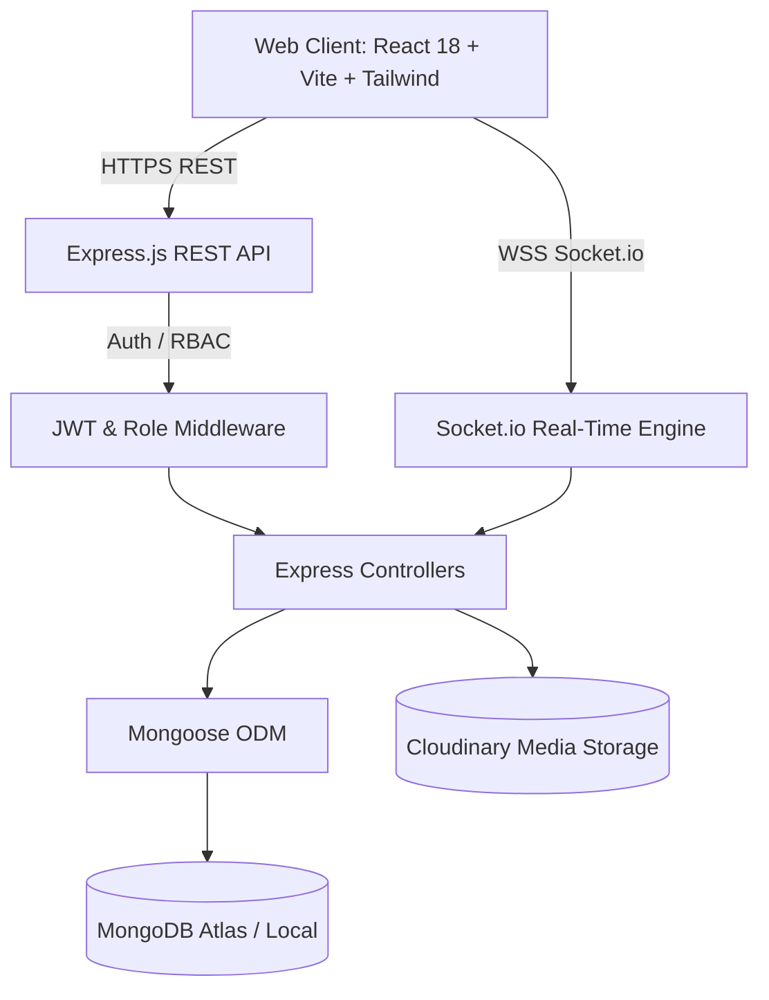
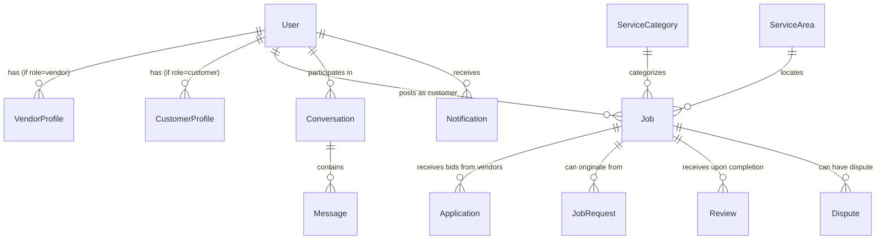

# WorkLogy — System Architecture (`ARCHITECTURE.md`)

This document provides a comprehensive technical overview of the **WorkLogy** platform, detailing system architecture, data models, API conventions, real-time messaging, and security architecture.

---

## 1. System Overview

WorkLogy is a modern, hyperlocal service marketplace that connects consumers with verified skilled professionals (electricians, plumbers, HVAC technicians, carpenters, painters, cleaners) for on-demand booking, job posting, transparent bidding, and real-time coordination.



---

## 2. Technology Stack

| Layer | Technology | Purpose |
| :--- | :--- | :--- |
| **Frontend Framework** | React 18 (SPA) | Component-driven declarative UI |
| **Build Tool** | Vite 6 | Rapid HMR and optimized production bundles |
| **Styling** | Tailwind CSS v3 | Utility-first responsive design system |
| **Icons** | Lucide React | Clean, consistent UI iconography |
| **State Management** | React Context API | Centralized auth & socket connection states |
| **HTTP Client** | Axios | Interceptor-enabled REST client with JWT handling |
| **Backend Runtime** | Node.js (ES Modules) | Asynchronous backend server runtime |
| **Web Framework** | Express.js 4.x | RESTful API routing and middleware pipeline |
| **Real-Time Engine** | Socket.IO 4.x | Bidirectional websockets for live chat & job alerts |
| **Database & ODM** | MongoDB + Mongoose 8.x | Document database with schema validation |
| **Security & Auth** | JWT + bcryptjs | Stateless auth tokens & salted password hashing |
| **File Storage** | Multer + Cloudinary | Multi-part uploads & cloud media optimization |

---

## 3. Frontend Architecture

### 3.1 Directory Organization
```text
frontend/src/
├── api/             # API client instances (axios.js, domain APIs)
├── assets/          # Static SVGs, logos, graphics
├── components/      # Reusable UI component modules
│   ├── common/      # Navbar, Footer, Loader, Modal, Button
│   ├── cards/       # VendorCard, JobCard, CategoryCard
│   ├── chat/        # ChatWindow, MessageBubble, TypingIndicator
│   ├── job/         # JobStatusTracker, ProposalCard
│   └── vendor/      # VerifiedBadge, OnboardingStepper
├── context/         # AuthContext (JWT/demo logins), SocketContext
├── hooks/           # useAuth, useSocket, useLocation
├── layouts/         # PublicLayout, CustomerLayout, VendorLayout, AdminLayout
├── pages/           # Route views organized by portal
│   ├── public/      # Landing, discovery, auth, info pages
│   ├── customer/    # Customer dashboard, job creation, tracking, chat
│   ├── vendor/      # Pro portal, job browsing, bids, calendar, earnings
│   └── admin/       # Management command center, users, categories, logs
├── routes/          # AppRoutes, ProtectedRoute, RoleRoute
└── utils/           # Formatters, constants, helpers
```

### 3.2 Layout & Routing Pattern
WorkLogy implements a 4-tier layout model with role-based routing guards:
1. **`PublicLayout`**: Accessible to all visitors. Includes top navigation, category menus, and footer.
2. **`CustomerLayout`**: Tailored for consumers. Includes job dispatch actions, active booking badges, and message drawers.
3. **`VendorLayout`**: Specialized for service providers. Includes availability toggles, earnings telemetry, and job lead feeds.
4. **`AdminLayout`**: Command center layout for platform administrators with sidebar analytics, dispute escalation, and audit controls.

---

## 4. Backend Architecture

### 4.1 Application Pipeline
```text
Request 
  ──► cors() & helmet() & express.json()
  ──► morgan() logging
  ──► apiLimiter (Express-Rate-Limit)
  ──► Routes (/api/auth, /api/jobs, etc.)
  ──► authenticate (JWT Verification)
  ──► authorize(...roles) (RBAC Validation)
  ──► validate(schema) (Express-Validator)
  ──► Controller Action
  ──► Response / errorHandler()
```

### 4.2 Modular Route Structure
The backend isolates domain logic into single-responsibility routes and controllers:
- `/api/auth` — Registration, login, password management, profile retrieval
- `/api/users` — User profile management, address book
- `/api/vendors` — Pro onboarding, verification documents, portfolio, service listings
- `/api/jobs` — Customer job postings, lifecycle updates, direct bookings
- `/api/job-requests` — On-demand direct service requests
- `/api/applications` — Vendor proposals, bids, and counter-offers
- `/api/chat` — Conversations and message retrieval
- `/api/reviews` — Two-way ratings, feedback, and vendor trust scores
- `/api/notifications` — In-app alerts and notifications
- `/api/categories` — Service categories and standardized pricing bounds
- `/api/areas` — Hyperlocal serviceable zones and zip codes
- `/api/disputes` — Escalations, arbitration, and refund handling
- `/api/admin` — System analytics, user bans, category approvals, audit logs

---

## 5. Data Model & Schema Relationships



### Core Schema Highlights:
1. **`User`**: Base identity (name, email, phone, role `['customer', 'vendor', 'admin']`, isActive).
2. **`VendorProfile`**: Pro details (businessName, bio, experienceYears, hourlyRate, servicesOffered, serviceAreas, verificationStatus `['pending', 'verified', 'rejected']`, documents, rating, completedJobsCount).
3. **`CustomerProfile`**: Saved addresses, preferred payment methods, emergency contacts.
4. **`Job`**: Title, description, category, location (GeoJSON coordinates + address), budget, urgency, status `['draft', 'open', 'assigned', 'in_progress', 'completed', 'cancelled']`.
5. **`Application`**: Vendor bid, proposal cover note, proposedPrice, estimatedDuration, status `['pending', 'accepted', 'rejected', 'withdrawn']`.
6. **`Conversation` & `Message`**: Direct communication between customer and vendor, referencing jobId.
7. **`Review`**: Rating (1-5), reviewText, punctualityRating, qualityRating, jobId, author, targetUser.
8. **`Dispute`**: Reason, status `['opened', 'under_review', 'resolved']`, refundAmount, resolutionNotes.
9. **`ActivityLog`**: System-wide audit trail for compliance, role actions, and admin overrides.

---

## 6. Real-Time Architecture (Socket.IO)

The platform utilizes Socket.IO for sub-second communication across three specialized channels:
1. **Chat Channel (`chat.socket.js`)**:
   - `join_chat`: Subscribes user to a specific conversation room.
   - `send_message`: Emits live message to active room participants.
   - `typing`: Broadcasts typing indicators.
2. **Job Tracking Channel (`job.socket.js`)**:
   - `job_status_changed`: Broadcasts status updates (`assigned`, `in_progress`, `completed`).
   - `vendor_location_update`: Emits live GPS coordinate updates for en-route service professionals.
3. **Lead Dispatch Channel (`lead.socket.js`)**:
   - `new_lead`: Alerts matching vendors in the specific `serviceArea` when an open job is posted.

---

## 7. Security Architecture

1. **Authentication**: Stateless JSON Web Tokens (JWT) signed with HMAC SHA-256 containing `id` and `role`. Expiration set to 7 days.
2. **Password Security**: Passwords hashed using `bcryptjs` with salt work factor of 10. Passwords never returned in queries (`select: false`).
3. **Role-Based Access Control (RBAC)**: Express middleware `authorize('admin')` or `authorize('vendor', 'admin')` verifies role integrity before controller execution.
4. **Rate Limiting**: `express-rate-limit` throttles API requests (100 requests per 15 minutes default; strict 10 requests per 15 minutes on auth endpoints).
5. **Data Protection**: CORS restricted to approved `FRONTEND_URL`. Sensitive environment variables stored in `.env` and excluded from version control.
